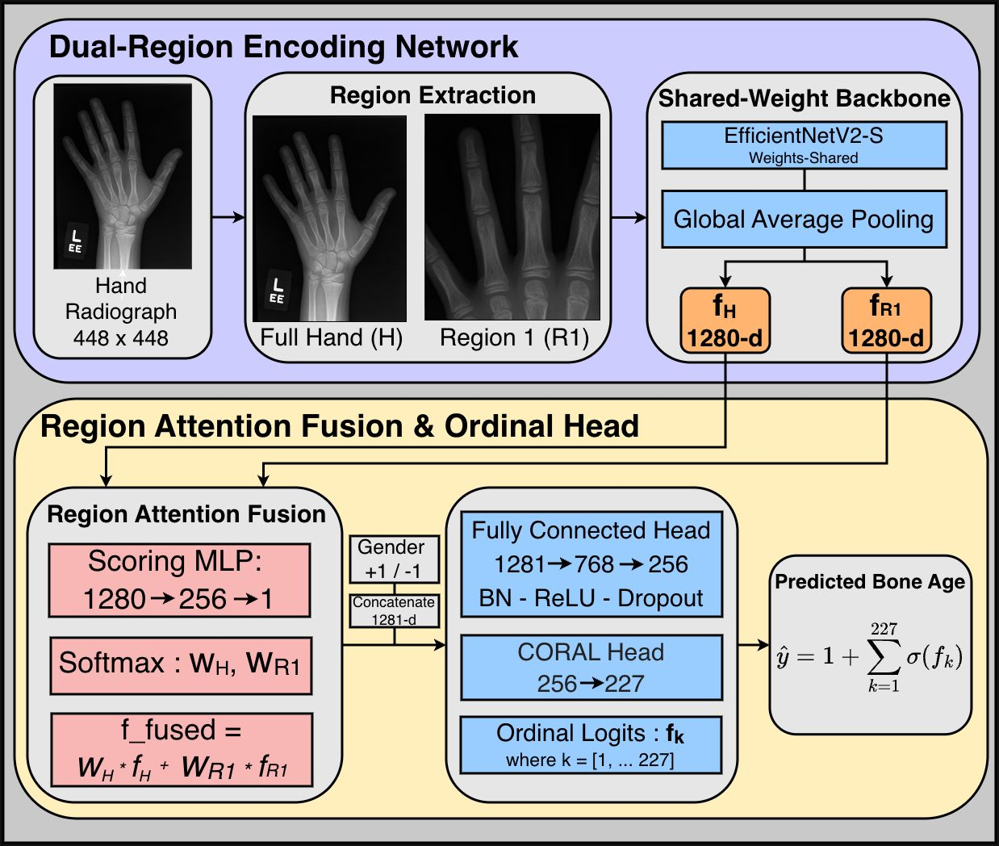

# Dual-Region Attention Fusion with Ordinal Regression for Efficient Pediatric Bone Age Estimation

Code for the paper *"Dual-Region Attention Fusion with Ordinal Regression for Efficient
Pediatric Bone Age Estimation"*, submitted to IEEE INDICON 2026.

Two anatomical regions of each hand radiograph — the full hand (H) and a targeted
finger-joint region (R1) — are encoded by a **shared-weight EfficientNetV2-S**. A
**region attention module** scores each region's feature vector and fuses them by a learned
weighted sum. Gender is concatenated as a conditioning signal, and a **CORAL ordinal
regression head** with 227 thresholds predicts bone age, trained with a hybrid
**CORAL + Huber** loss. EMA weight smoothing and horizontal-flip TTA stabilise training and
inference.

**MAE 5.825 months** on RSNA · **21.7 M parameters** · **54.3 ms / patient**



---

## Results

### RSNA Pediatric Bone Age

| Inference | MAE (months) |
|---|---|
| Standard | 5.921 |
| Test-Time Augmentation (TTA) | **5.825** |

### Ablations

| Configuration | MAE (months) |
|---|---|
| Hand only (H) | 6.143 |
| Hand + Region-1 (H+R1) | **5.921** |

| Loss | MAE (months) |
|---|---|
| CORAL only | 6.041 |
| CORAL + Huber | **5.921** |

### Efficiency (NVIDIA A100, batch size 1)

| Metric | Value |
|---|---|
| Total parameters | 21.7 M |
| FLOPs | 43.3 G |
| Standard inference | 54.3 ms / patient (18.4 patients/s) |
| TTA inference | 108.2 ms / patient (9.2 patients/s) |

### Cross-dataset: Digital Hand Atlas (DHA), zero-shot

| Subgroup | MAE (months) |
|---|---|
| **Overall** | **11.61** |
| Male | 10.62 |
| Female | 12.61 |
| African American | 12.15 |
| Asian | 12.28 |
| Caucasian | 10.78 |
| Hispanic | 11.24 |
| 0–3 yr | 6.87 |
| 3–6 yr | 7.70 |
| 6–11 yr | 11.86 |
| 11+ yr | 12.92 |

---

## Repository structure

```
├── scripts/
│   ├── main/
│   │   ├── train.py                 # main model, k-fold training
│   │   └── train_modified.py        # main model, fixed 500-image held-out runs
│   ├── ablations/
│   │   ├── ablation_hand_only.py    # hand region only
│   │   └── train_coral.py           # CORAL loss only
│   └── evaluation/
│       ├── dha_zero_shot.py         # zero-shot evaluation on DHA with subgroup breakdown
│       ├── dha_finetune.py          # stratified 80/20 fine-tuning on DHA
│       └── profile_efficiency.py    # parameters, FLOPs, latency (Table IV)
├── notebooks/
│   ├── 00_region_extraction.ipynb                 # hand / region-1 / region-2 patch extraction
│   ├── 01_effnetb0_ldl_baseline.ipynb             # EfficientNet-B0 + label distribution learning
│   ├── 02_two_stage_attention_roi.ipynb           # attention-guided ROI crop + distribution learning
│   ├── 03_hr1_effnetb3_tta.ipynb                  # H+R1 channel-stacked EfficientNet-B3 + TTA
│   ├── 04_hr1r2_single_pass_attention_ema.ipynb   # H+R1+R2 single-pass attention, EMA, LDL
│   ├── 05_multi_region_ldl_effnetv2.ipynb         # multi-region distribution learning, EfficientNetV2
│   ├── 06_multi_backbone_patch_fusion.ipynb       # multi-backbone hand–region fusion
│   ├── 07_gnn_ensemble.ipynb                      # age-aware attention + graph neural network
│   ├── 08_ordinal_multipatch_soft_labels.ipynb    # ordinal multi-patch, spatial attention, soft labels
│   └── 09_ordinal_latent_curriculum.ipynb         # ordinal latent variable, curriculum binning
├── misc/                        # architecture diagram and figure sources
├── samples/                     # example radiographs (RSNA, DHA)
└── requirements.txt
```

The notebooks are the design-exploration experiments that led to the final architecture,
kept with their original outputs.

## Setup

```bash
pip install -r requirements.txt
```

### Data

* **RSNA** — [RSNA Pediatric Bone Age Challenge 2017](https://www.rsna.org/rsnai/ai-image-challenge/rsna-pediatric-bone-age-challenge-2017)
  (training set: 12,611 left-hand radiographs, ages 1–228 months).
* **DHA** — [Digital Hand Atlas](https://ipilab.usc.edu/BAAweb), Image Processing and
  Informatics Lab, University of Southern California: 1,390 hand radiographs of children
  aged 0–18 years from four ethnic groups (African American, Asian, Caucasian, Hispanic).
  Expected label file: `id, boneage, male, ethnicity`.

```
data/
├── rsna/
│   ├── boneage-training-dataset.csv
│   ├── boneage-training-dataset/<id>.png
│   └── patches/{hand,region1}/<id>.jpg      # created by notebooks/00_region_extraction.ipynb
└── dha/
    ├── dha_labels.csv
    └── patches/{hand,region1}/<id>.jpg
```


### Training details

| Setting | Value |
|---|---|
| Backbone | EfficientNetV2-S (ImageNet-pretrained, weights shared across both streams) |
| Input | 448 × 448 per region, ImageNet normalisation |
| Augmentation | horizontal flip, brightness/contrast jitter (identical for both regions) |
| Ordinal head | 227 thresholds, ages 1–228 months |
| Loss | 0.6 · CORAL + 1.0 · Huber |
| Optimiser | AdamW, lr 3e-4, weight decay 0.01 |
| Gradient clipping | 5.0 |
| EMA decay | 0.999 |
| Precision | automatic mixed precision |
| Hardware | NVIDIA A100 |

---

## Citation

```bibtex
@inproceedings{dualregion_boneage_2026,
  title     = {Dual-Region Attention Fusion with Ordinal Regression for Efficient Pediatric Bone Age Estimation},
  author    = {TODO},
  booktitle = {Proceedings of the IEEE India Council International Conference (INDICON)},
  year      = {2026}
}
```

## References

1. S. S. Halabi et al., "The RSNA Pediatric Bone Age Machine Learning Challenge," *Radiology*, vol. 290, no. 2, pp. 498–503, 2019.
2. A. Gertych, A. Zhang, J. Sayre, S. Pospiech-Kurkowska, and H. K. Huang, "Bone age assessment of children using a digital hand atlas," *Computerized Medical Imaging and Graphics*, vol. 31, no. 4–5, pp. 322–331, 2007.
3. W. Cao, V. Mirjalili, and S. Raschka, "Rank consistent ordinal regression for neural networks with application to age estimation," *Pattern Recognition Letters*, vol. 140, pp. 325–331, 2020.
4. M. Tan and Q. V. Le, "EfficientNetV2: Smaller models and faster training," in *Proc. ICML*, 2021, pp. 10096–10106.
5. I. Loshchilov and F. Hutter, "Decoupled weight decay regularization," in *Proc. ICLR*, 2019.
6. W. W. Greulich and S. I. Pyle, *Radiographic Atlas of Skeletal Development of the Hand and Wrist*, 2nd ed. Stanford Univ. Press, 1959.
7. J. M. Tanner, R. H. Whitehouse, and W. A. Marshall, *Assessment of Skeletal Maturity and Prediction of Adult Height (TW2 Method)*. Academic Press, 1975.

## Acknowledgements

We thank the RSNA for the Pediatric Bone Age dataset and the USC Image Processing and
Informatics Lab for the Digital Hand Atlas.
